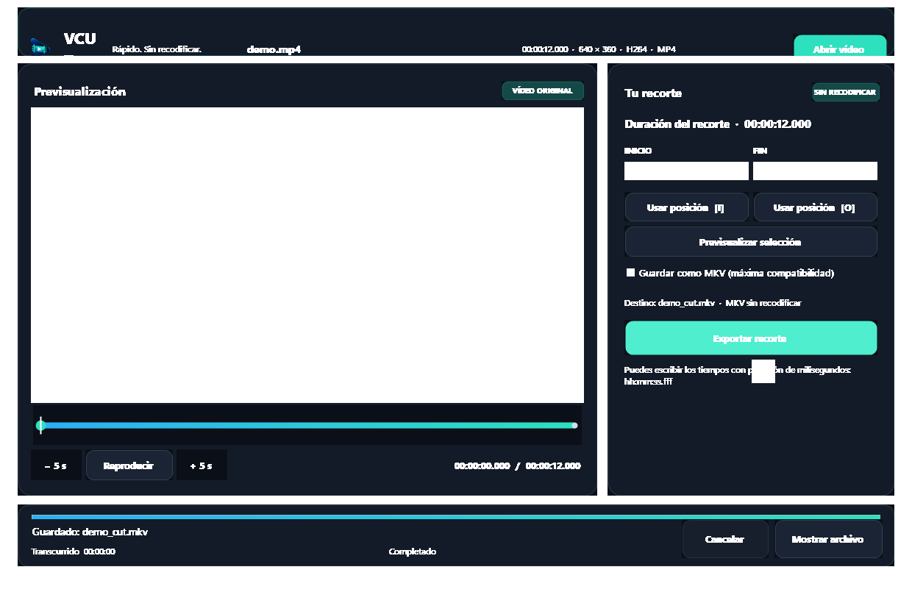

<p align="center">
  
</p>

<h1 align="center">VCUT</h1>

<p align="center"><strong>Recorta rápido. Conserva la calidad.</strong></p>

<p align="center">
  
  
  
  
</p>

Aplicación de escritorio **VCutStudio** en **C#, Windows Forms y .NET 10** para recortar vídeos mediante copia directa de sus pistas, sin recodificarlas.



Consulta el **[manual completo](docs/MANUAL.md)** para conocer características, formatos, atajos, arquitectura, publicación y solución de problemas.

## Abrir y usar

Abre `VCutStudio.slnx` con **Visual Studio 2026**, selecciona **VCutStudio** como proyecto de inicio y pulsa F5. También puedes ejecutar `bin/Debug/net10.0-windows/VCutStudio.exe` después de compilar. La salida de desarrollo necesita su carpeta completa; para distribuir un único archivo utiliza la publicación portable descrita más abajo.

1. Pulsa **Abrir vídeo** o arrastra un archivo a la ventana.
2. Reproduce, salta cinco segundos o desplázate por la línea de tiempo (pasa el ratón para ver una miniatura cada 0,5 s, o haz clic y arrastra sin soltar para actualizar al instante el **Monitor de estudio** a máxima calidad). Usa **[ I ] Fijar inicio** y **Fijar fin [ O ]**, o escribe las marcas como `hh:mm:ss.fff`.
3. **Previsualizar intervalo seleccionado** permite comprobar el fragmento elegido.
4. Si el contenedor original no acepta alguna pista, activa **Guardar como MKV**. Si necesitas garantizar un archivo inferior a 200 MB manteniendo la calidad de imagen y el sonido original, activa **Reducir tamaño a < 200 MB (códec HEVC/H.265 · sin pérdida visual)**.
5. Pulsa **EXPORTAR RECORTE SIN PÉRDIDA**. El resultado se guarda junto al original: `vacaciones.mp4` → `vacaciones_cut.mp4` o `vacaciones_cut.mkv`.
6. **Mostrar archivo** selecciona el resultado en el Explorador de archivos.

Atajos: **Ctrl+O** abrir, **Espacio** reproducir/pausar, **I** inicio y **O** fin. Dentro de un campo de tiempo las teclas se usan para editar. La aplicación inicia maximizada, coloca los paneles lado a lado en ventanas amplias y los apila con desplazamiento vertical cuando falta espacio. Admite escalado DPI.

Durante el recorte se muestran progreso, tiempo transcurrido y tiempo restante **estimado**. Los recortes cortos pueden terminar antes de disponer de una estimación. Puedes cancelar; al cerrar durante una operación se cancela y se espera a limpiar el archivo temporal.

## Ejecutable portable

La publicación `win-x64` incluye el runtime .NET 10, FFmpeg, FFprobe, LibVLC y sus plugins en un único ejecutable. El equipo destino no necesita instalar esas dependencias.

```powershell
powershell -NoProfile -ExecutionPolicy Bypass -File scripts\Publish-Portable.ps1
```

El resultado se crea en `dist\VCUT-win-x64\VCutStudio.exe`. El primer arranque puede tardar unos segundos mientras se extraen los componentes nativos en la carpeta temporal de Windows.

## Requisitos y dependencias

- Windows x64 y SDK .NET 10 para desarrollar; .NET Desktop Runtime 10 para ejecutar una compilación dependiente del framework.
- **Visual Studio 2026 18.0 o posterior** con la carga de trabajo de desarrollo de escritorio .NET.
- `LibVLCSharp.WinForms 3.10.2` y `VideoLAN.LibVLC.Windows 3.0.24` para el reproductor. No necesitas instalar VLC.
- FFmpeg y FFprobe portables en `tools/ffmpeg`, descargados y verificados por SHA256. No se modifica el PATH.

Las dependencias están preparadas en esta copia. En una copia nueva:

```powershell
powershell -NoProfile -ExecutionPolicy Bypass -File scripts\Setup-FFmpeg.ps1
dotnet restore VCutStudio.slnx
dotnet build VCutStudio.slnx
```

El script conserva la versión, origen y SHA256 en `tools/ffmpeg/download-info.txt`, junto con la licencia. NuGet usa `.packages` dentro del repositorio. Consulta `THIRD-PARTY-NOTICES.md` para las licencias.

## Precisión y formatos

El recorte ejecuta FFmpeg con `-ss` antes de la entrada, `-t`, `-map 0` y `-c copy`. **No hay recodificación de vídeo ni de audio.** Conserva las pistas y sus metadatos; no copia los capítulos originales porque sus tiempos ya no corresponden al fragmento.

La copia directa depende de los **fotogramas clave**: el fragmento puede empezar antes de la marca y la duración puede variar ligeramente. La previsualización muestra las marcas solicitadas, no una simulación exacta del resultado del remultiplexado. Un corte exacto en cualquier fotograma requiere otro modo con recodificación, que no forma parte de esta versión.

El selector incluye MP4, MKV, MOV, AVI, WebM, TS, MXF, Ogg, FLV, ASF/WMV, DV, RM/RMVB, Y4M y muchos otros. La opción **Todos los archivos** permite intentar cualquier formato reconocido por FFprobe. Ningún motor garantiza literalmente todos los formatos. Para mantener la extensión original, su contenedor debe admitir todas las pistas. La opción **Guardar como MKV** remultiplexa el recorte a Matroska, un contenedor más flexible, manteniendo `-map 0` y `-c copy`; no descarta pistas ni recodifica vídeo o audio.

VCutStudio detecta los adaptadores gráficos del equipo (priorizando GPU dedicada) y precarga el vídeo en memoria RAM por defecto, solicitando a LibVLC decodificación por hardware para la previsualización cuando hay una GPU disponible. El recorte y la salida MKV no necesitan GPU: la copia directa mueve paquetes comprimidos sin decodificarlos ni codificarlos.

Cada sesión y operación queda registrada en `vcut.log`, junto al ejecutable. Cada línea incluye fecha, hora y zona horaria; los fallos incluyen la excepción y su traza completa. Si esa carpeta no permite escritura, el registro se guarda en `%LOCALAPPDATA%\VCUT\vcut.log`. Al alcanzar 5 MB, el registro anterior pasa a `vcut.previous.log`.

El original no se modifica. Si ya existe `_cut`, se pide renombrarlo o moverlo; no se sobrescribe. El resultado primero se escribe en un archivo temporal único en la carpeta de origen, se valida con FFprobe y después se renombra al destino final.

## Pruebas en cada compilación

`VCUT.Tests` es un proyecto MSTest en C# independiente de la interfaz. Se compila como dependencia de construcción de VCutStudio (sin enlazar su ensamblado a la aplicación) y su destino `RunTestsAfterBuild` ejecuta VSTest sobre el ensamblado recién compilado. Un fallo devuelve un error de compilación. La comprobación rápida de Visual Studio está desactivada en ambos proyectos para que **Compilar** vuelva a ejecutar las pruebas aunque no haya cambios.

Las 59 pruebas cubren validación de marcas, nombres de salida original y MKV, modo de alta eficiencia `< 200 MB` con códec HEVC/H.265 (`hevc_nvenc`/`hevc_qsv`/`hevc_amf`/`libx265`), detección de GPU, caché RAM, lector nativo ISO-BMFF, caché de fotogramas a resolución nativa cada 0,5 s, ecualizador informativo de sonido/silencio (`AudioWaveformService`), tiempos y culturas, metadatos, progreso, estimación, cancelación, limpieza de temporales, archivos existentes y recortes reales. Los vídeos sintéticos se crean en una carpeta temporal única y se eliminan después. Se comparan hashes SHA256 de paquetes de vídeo para verificar que sus bytes se conservan, además de decodificar el resultado y comprobar las pistas de audio.

```powershell
# Compilar y probar (Debug o Release)
dotnet build VCutStudio.slnx
dotnet build VCutStudio.slnx -c Release

# Repetir solo las pruebas ya compiladas
dotnet test VCUT.Tests\VCUT.Tests.csproj --no-build
```

Para publicar después de verificar las pruebas:

```powershell
dotnet publish VCutStudio.csproj -c Release -p:RunTestsOnBuild=false -o artifacts\publish
```

`RunTestsOnBuild=false` es una exclusión explícita para empaquetado; no es el valor predeterminado. No hay compilaciones recursivas: VSTest no recompila. En entornos con procesos MSBuild restringidos se puede usar `--disable-build-servers -m:1 -nr:false`.

## Estructura y mantenimiento

- `principal.Main.cs`: interfaz del formulario `principal`, estado de operaciones y reproducción VLC; `principal.cs` y `principal.Designer.cs` contienen la definición base del formulario.
- `VCUT.Core`: análisis de archivos, validación de intervalos, argumentos FFmpeg, ejecución/cancelación de procesos y estimación de progreso.
- `VCUT.Tests`: pruebas unitarias y de integración del motor.
- `scripts/Setup-FFmpeg.ps1`: preparación reproducible de las herramientas portables y registro de descarga.
- `Assets`: imagen fuente, marca transparente e icono multirresolución de VCUT.
- `Controls`: tema visual y controles WinForms adaptados a la nueva interfaz.
- `scripts/Build-BrandAssets.ps1`: regenera `vcut-mark.png` y `vcut.ico` a partir de la imagen fuente.
- `scripts/Publish-Portable.ps1`: compila, prueba y genera el EXE único autocontenido.
- `docs/MANUAL.md`: manual de usuario y referencia técnica para GitHub.
- `PROJECT_CONTEXT`: historial, decisiones, versiones y punto de continuidad para futuras IAs.

Al añadir una funcionalidad o corregir un error del motor, ampliar las pruebas del comportamiento correspondiente y ejecutar una compilación normal con pruebas activadas. Mantener la lógica comprobable fuera del formulario.
