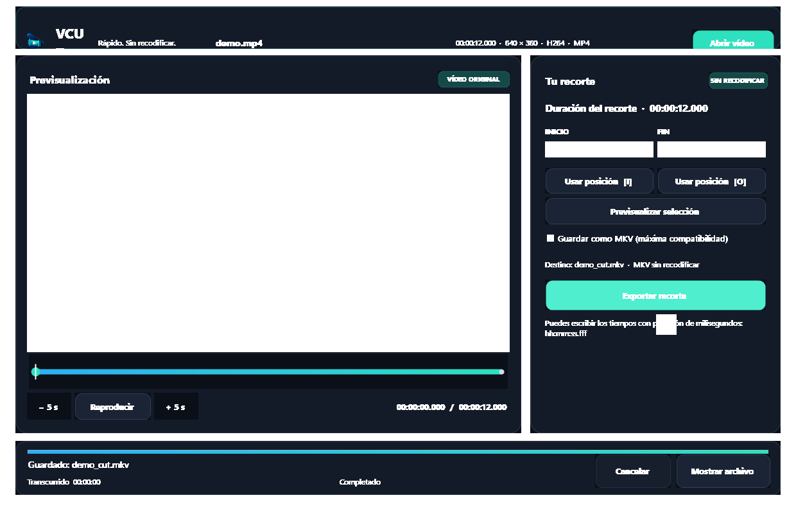
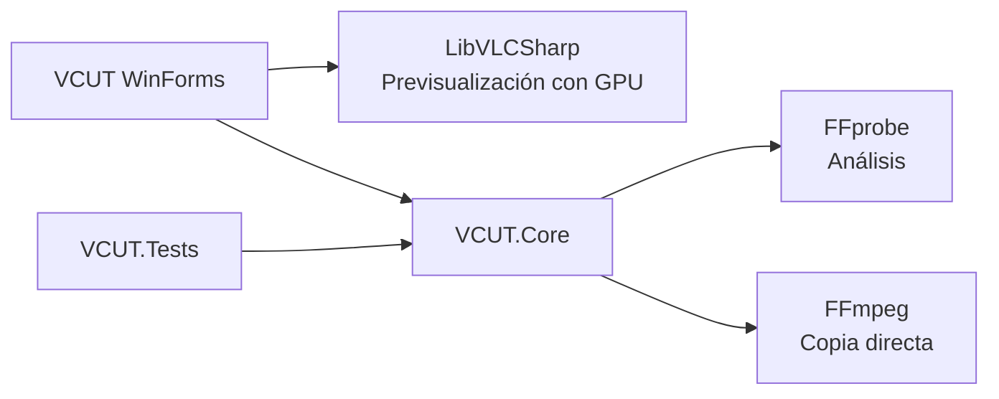

<p align="center">
  
</p>

<h1 align="center">VCUT</h1>

<p align="center"><strong>Recorta rápido. Conserva la calidad.</strong></p>

<p align="center">
  
  
  
  
  
</p>

**VCutStudio** es una aplicación de escritorio para extraer un intervalo de un vídeo mediante **copia directa de las pistas**. El vídeo y el audio no se vuelven a codificar, por lo que el proceso es ultrarrápido y mantiene los datos originales al 100%.



## ✨ Características

- 🎬 Carga manual o mediante arrastrar y soltar con precalentamiento instantáneo, lector nativo ISO-BMFF (`moov`) en < 1 ms y barra de progreso de análisis.
- ⏱️ Marcas de inicio y fin con precisión de milisegundos.
- ▶️ Reproductor integrado, previsualización del intervalo y controles interactivos destacados.
- ↔️ Línea de tiempo interactiva con forma de onda estilizada, selección gráfica con gradiente, **vista previa flotante del fotograma a máxima calidad al pasar el ratón (2 fotogramas por segundo / cada 0,5 s)**, **carga inmediata y fluida en el Monitor de estudio al hacer clic o arrastrar sin soltar (caché multinúcleo en RAM con interpolación `HighQualityBicubic` y resolución nativa)** y saltos de cinco segundos.
- ✂️ Recorte mediante `-c copy`, sin recodificar vídeo ni audio.
- 📦 Conservación de todas las pistas y metadatos compatibles con el contenedor.
- 🧰 Salida MKV opcional para combinaciones de pistas que el contenedor original no admite.
- 🎮 Detección de GPU dedicada (NVIDIA CUDA, AMD AMF, Intel QSV), preferencia de alto rendimiento DirectX y precarga activa del vídeo en memoria RAM por defecto.
- ⚡ Caché precompilada de plugins de LibVLC (`plugins.dat`) e inspección rápida de cabeceras con `FFprobe` para aperturas de vídeo en milisegundos.
- 🏷️ Micro-píldoras dinámicas de metadatos: contenedor, resolución (4K/1080p/720p), códecs de vídeo/audio, duración y estado de GPU + RAM.
- 🧾 Registro `vcut.log` con fecha y hora en cada línea y detalles completos de los fallos.
- 🛡️ El original nunca se modifica y los resultados existentes no se sobrescriben.
- 📊 Progreso, tiempo transcurrido y tiempo restante estimado.
- 🖥️ Inicio maximizado por defecto, diseño adaptable, escalado DPI y navegación por teclado.
- 🧳 Publicación portable de un único EXE (`VCutStudio.exe`), con .NET, FFmpeg y LibVLC incluidos.
- ✅ 55 pruebas unitarias y de integración ejecutadas en cada compilación.

## 🚀 Uso

1. Abre `VCutStudio.exe`.
2. Pulsa **Abrir vídeo** o arrastra un archivo sobre la ventana.
3. Reproduce el vídeo o usa la línea de tiempo (haciendo clic o arrastrando sin soltar) para localizar el comienzo en el **Monitor de estudio**.
4. Pulsa **[ I ] Fijar inicio** para fijar el inicio.
5. Localiza el final y pulsa **Fijar fin [ O ]**.
6. Comprueba el intervalo con **Previsualizar intervalo seleccionado**.
7. Activa **Guardar como MKV** si quieres usar Matroska como contenedor de salida.
8. Pulsa **EXPORTAR RECORTE SIN PÉRDIDA**.

El resultado se guarda en la carpeta del original, conservando la extensión y añadiendo `_cut`:

```text
vacaciones.mp4  →  vacaciones_cut.mp4
vacaciones.mp4  →  vacaciones_cut.mkv  (con la opción MKV)
```

Si el archivo de salida ya existe, VCUT pide renombrarlo o moverlo. No lo reemplaza automáticamente.

### Atajos

| Atajo | Acción |
|---|---|
| `Ctrl+O` | Abrir un vídeo |
| `Espacio` | Reproducir o pausar |
| `I` | Usar la posición actual como inicio |
| `O` | Usar la posición actual como fin |
| `←` / `→` sobre la línea de tiempo | Desplazamiento preciso |

## 🎞️ Formatos y códecs

El selector incluye MP4, MKV, MOV, AVI, WebM, M4V, TS, MTS, M2TS, WMV, ASF, FLV, F4V, MPEG, VOB, 3GP, 3G2, OGV, OGG, MXF, DV, DivX, RM, RMVB, MJPEG, Y4M, NUT, WTV, DVR-MS, AMV, RoQ y NSV. **Todos los archivos** permite intentar cualquier otro formato reconocido por FFprobe.

La compilación incluida de FFmpeg 9.0.2 expone cientos de demultiplexores y códecs. Entre los más habituales:

| Tipo | Ejemplos |
|---|---|
| Vídeo | H.264/AVC, H.265/HEVC, AV1, VP8, VP9, MPEG-2, MPEG-4, Theora, ProRes, DNxHD/DNxHR, MJPEG, Xvid |
| Audio | AAC, MP3, AC-3, E-AC-3, Opus, Vorbis, FLAC, ALAC, PCM, DTS |
| Contenedores | MP4/MOV, Matroska/MKV, WebM, MPEG-TS, AVI, ASF/WMV, MXF, Ogg, FLV |

VCUT no necesita decodificar el contenido para recortarlo: copia los paquetes existentes. El contenedor de salida debe aceptar todas las pistas de origen. Si una combinación no es válida, activa **Guardar como MKV (máxima compatibilidad)**. Matroska admite más combinaciones de vídeo, audio, subtítulos y datos, y VCUT mantiene todas las pistas con `-map 0` y `-c copy`.

### GPU

Al iniciar, VCUT detecta los adaptadores gráficos conectados. Si encuentra una GPU de hardware, LibVLC intenta usarla para decodificar la **previsualización**. Si el controlador o el formato no permiten aceleración, LibVLC puede recurrir al procesador.

El recorte y el remultiplexado a MKV no usan codificación por GPU porque no hay recodificación: FFmpeg copia los paquetes comprimidos. Añadir un codificador NVENC, QSV o AMF cambiaría los datos del vídeo y dejaría de ser el modo sin pérdida actual.

## 🧾 Registro de actividad

VCUT crea `vcut.log` junto a `VCUT.exe`. Registra el inicio y cierre, versión, entorno, GPU detectada, vídeos cargados, contenedor elegido, marcas, destino, duración, tamaño final, cancelaciones y errores. Cada línea tiene fecha, hora, milisegundos y zona horaria.

Los fallos guardan el tipo de excepción, mensaje y traza completa, con una marca temporal en **cada línea**. Si la carpeta del ejecutable es de solo lectura, se usa `%LOCALAPPDATA%\VCUT\vcut.log`. Cuando el archivo llega a 5 MB, VCUT lo conserva como `vcut.previous.log` y comienza uno nuevo.

### Precisión de los cortes

La copia directa está condicionada por los **fotogramas clave**. El inicio real puede ajustarse al fotograma clave anterior y la duración puede variar ligeramente. Un corte exacto en cualquier fotograma requeriría un modo adicional con recodificación.

## 📦 Ejecutable portable

La publicación `win-x64` es autocontenida y de archivo único:

- No requiere instalar .NET 10.
- No requiere instalar VLC, FFmpeg ni FFprobe.
- No modifica el `PATH` ni necesita instalación.
- Funciona en Windows x64 compatible.

El EXE incluye todos los motores y ronda los 260–280 MB. En el primer inicio puede tardar unos segundos mientras Windows extrae los componentes nativos en su carpeta temporal.

Para generarlo:

```powershell
powershell -NoProfile -ExecutionPolicy Bypass -File scripts\Publish-Portable.ps1
```

Resultado:

```text
dist\VCUT-win-x64\VCutStudio.exe
```

## 🧰 Desarrollo

### Requisitos

- Visual Studio 2026 18.0 o posterior.
- Carga de trabajo **Desarrollo de escritorio .NET**.
- SDK .NET 10.
- Windows x64.

### Preparación

```powershell
powershell -NoProfile -ExecutionPolicy Bypass -File scripts\Setup-FFmpeg.ps1
dotnet restore VCutStudio.slnx
dotnet build VCutStudio.slnx
```

Las pruebas se ejecutan automáticamente al compilar. Un fallo de pruebas hace fallar la compilación.

### Arquitectura



| Componente | Responsabilidad |
|---|---|
| `principal.Main.cs` | Formulario `principal`, interfaz, reproducción y estado de operaciones |
| `Controls/` | Tema y controles WinForms personalizados en C# |
| `VCUT.Core/` | Validación, lector nativo ISO-BMFF, caché RAM, GPU, FFprobe, FFmpeg, progreso y cancelación |
| `VCUT.Tests/` | Pruebas unitarias, de rendimiento y recortes reales con vídeos sintéticos |
| `Assets/` | Logotipo, imagen fuente, icono multirresolución y caché `libvlc-plugins.dat` |
| `scripts/` | Preparación de FFmpeg, recursos de marca y publicación portable |

## 🧪 Pruebas

```powershell
dotnet build VCutStudio.slnx
dotnet build VCutStudio.slnx -c Release
dotnet test VCUT.Tests\VCUT.Tests.csproj --no-build
```

Las 55 pruebas verifican validación de intervalos, nombres de salida original y MKV, filtrado y priorización de adaptadores GPU, precarga en RAM, lector nativo MP4/MOV, generación de miniaturas cada 0,5 s (2 fps), culturas, progreso, cancelación, limpieza de temporales, protección contra sobrescrituras y recortes reales. Una prueba remultiplexa a MKV una combinación H.264/AAC incompatible con WebM y confirma que conserva las tres pistas y los bytes de los paquetes de vídeo.

## 🔒 Privacidad

VCUT procesa los vídeos localmente. No sube archivos, no usa servicios web y no recopila telemetría.

## ⚠️ Solución de problemas

| Problema | Solución |
|---|---|
| El primer inicio tarda | Es normal en el EXE único: se extraen dependencias nativas en la carpeta temporal. |
| El vídeo no se previsualiza | Aún puedes escribir las marcas y recortar si FFprobe reconoce el archivo. |
| FFmpeg rechaza la salida | Alguna pista no es compatible con el contenedor original. Activa **Guardar como MKV** y vuelve a exportar. |
| No aparece `vcut.log` junto al EXE | Busca `%LOCALAPPDATA%\VCUT\vcut.log`; se usa cuando la carpeta del programa no permite escritura. |
| El corte empieza antes | Es la limitación de los fotogramas clave en copia directa. |
| Ya existe `_cut` | Renombra o mueve el resultado anterior. VCUT no sobrescribe. |

## 📄 Licencias

Consulta [`THIRD-PARTY-NOTICES.md`](../THIRD-PARTY-NOTICES.md) para las licencias de FFmpeg, LibVLC y los paquetes NuGet utilizados.
